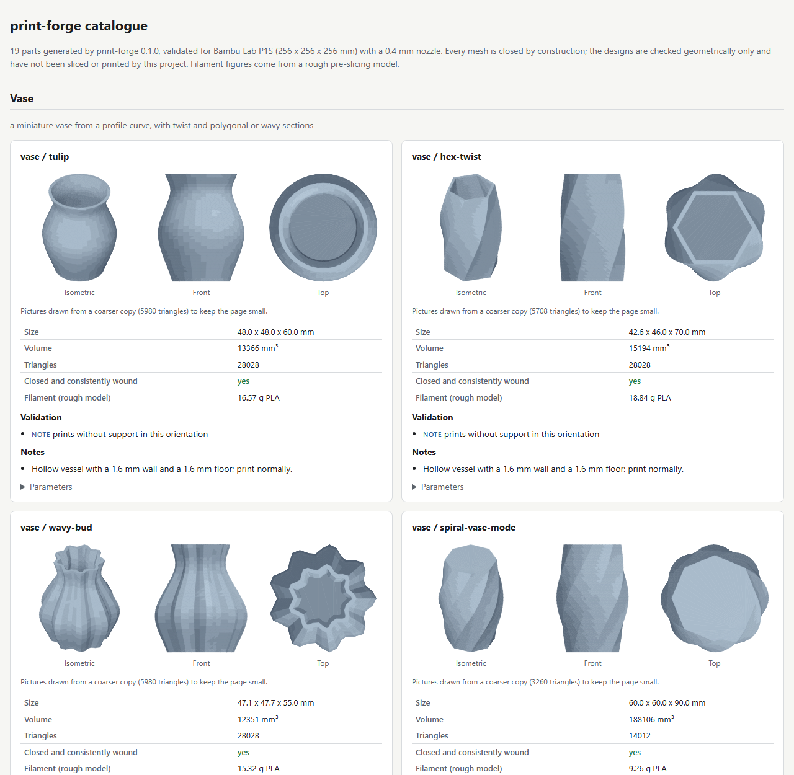
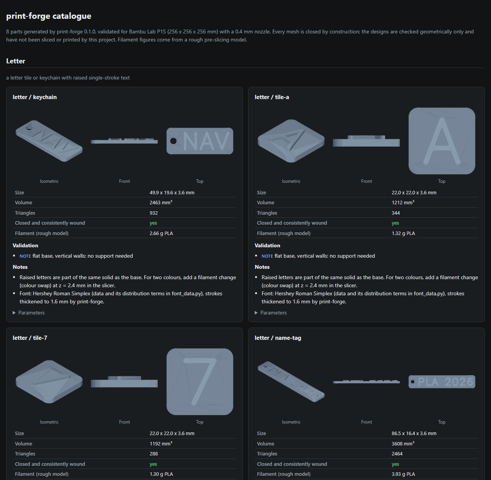
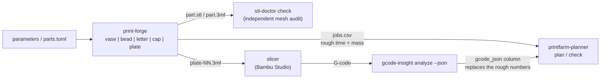

# print-forge

[](https://github.com/projectbin07-stack/print-forge/actions/workflows/ci.yml)
[](LICENSE)

Parametric generators for small FDM batch products -- miniature vases, beads, letter tiles and
keychains, clicker tops -- that write closed, slicer-ready meshes, pack them onto plates and
produce a batch plan.

## Why it exists

A small print farm making the same kinds of small PLA products in batches spends a lot of time on
the steps around the printer: drawing variants in CAD, exporting meshes that sometimes have holes
or flipped faces, arranging dozens of parts on each bed, and estimating how much filament and
printer time an order needs. print-forge does those steps from parameters:

- every product family is a parameterised generator with documented parameters, presets and
  printability rules (wall vs. nozzle, overhang limit for supportless printing, bed fit for the
  Bambu Lab P1S/A1 256 mm and A1 mini 180 mm beds);
- solids are **closed by construction** -- no mesh booleans anywhere -- and every family is
  checked for that with seeded random parameter sweeps and by an independent checker,
  [stl-doctor](https://github.com/projectbin07-stack/stl-doctor);
- a plate packer arranges many parts per bed and writes one 3MF per plate, plus a manifest and a
  jobs CSV that [printfarm-planner](https://github.com/projectbin07-stack/printfarm-planner)
  loads directly.

Runtime dependencies: the Python standard library only (numpy, if installed, speeds up volume and
area sums; the pure-Python path is tested to give the same result).





*Both screenshots are `print-forge catalogue` output rendered by headless Microsoft Edge. Every
picture is an inline SVG drawn by print-forge (orthographic projection, painter's algorithm); the
page has no JavaScript and loads nothing from the network.*

## What has and has not been validated

- **Geometrically validated:** every mesh print-forge generates is checked to be closed and
  consistently wound (each edge used by exactly two faces in opposite directions), to have
  positive volume and no vertices close enough for a reader to weld them, for all presets and for
  seeded random parameter sweeps (469 tests). Every preset also passes `stl-doctor check` with no
  errors (and no self-intersections) in the test suite and in CI.
- **Not validated by this project:** none of the designs have been sliced in Bambu Studio and
  printed as part of this project, so there is no evidence here of how they print, how strong
  they are, or how well the filament estimates match a slicer. Overhang, bridge and wall checks
  are geometric rules, not print results.
- **Cap stem fit must be test-printed.** The MX-style socket uses nominal numbers from an
  open-source keycap library plus clearance parameters. How tightly it grips a switch depends on
  the printer, nozzle, filament, line width and slicer settings. Print one cap, try it on a
  switch, adjust `--length-clearance` / `--width-clearance`, then print the batch.

## Install

```console
git clone https://github.com/projectbin07-stack/print-forge.git
cd print-forge
python -m pip install -e .            # or ".[fast]" to add numpy, ".[dev]" for the test tools
```

Python 3.10 or newer. print-forge is not published on PyPI.

## Quick start

All output below is real, copied from a terminal (Windows, Python 3.14).

```console
$ print-forge vase --preset tulip --height 60 --out vase.stl
print-forge 0.1.1  vase: vase-circle-60mm
  wrote      vase.stl (binary STL, 28028 triangles)
  size       47.99 x 47.99 x 60.00 mm  (Bambu Lab P1S (256 x 256 x 256 mm))
  volume     13366.4 mm^3, surface 16921.8 mm^2
  mesh       28028 triangles, closed and consistently wound, 1 shell(s)
  filament   ~16.57 g PLA (rough model: 2 walls x 0.42 mm, 15% infill)
  note       prints without support in this orientation
  -          Hollow vessel with a 1.6 mm wall and a 1.6 mm floor; print normally.
verdict: OK (0 errors, 0 warnings)

$ print-forge letter --text NAV --out nav.3mf
print-forge 0.1.1  letter: keychain-NAV
  wrote      nav.3mf (3MF, 920 triangles, units mm)
  size       45.84 x 18.00 x 3.60 mm  (Bambu Lab P1S (256 x 256 x 256 mm))
  volume     2071.9 mm^3, surface 2120.0 mm^2
  mesh       920 triangles, closed and consistently wound, 1 shell(s)
  filament   ~2.26 g PLA (rough model: 2 walls x 0.42 mm, 15% infill)
  note       flat base, vertical walls: no support needed
  -          Raised letters are part of the same solid as the base. For two colours, add a filament change (colour swap) at z = 2.4 mm in the slicer.
  -          Font: Hershey Roman Simplex (data and its distribution terms in font_data.py), strokes thickened to 1.6 mm by print-forge.
verdict: OK (0 errors, 0 warnings)

$ print-forge cap --preset legend-n --out cap.stl
print-forge 0.1.1  cap: cap-spherical-N
  wrote      cap.stl (binary STL, 1360 triangles)
  size       18.00 x 18.00 x 8.09 mm  (Bambu Lab P1S (256 x 256 x 256 mm))
  volume     921.2 mm^3, surface 1406.1 mm^2
  mesh       1360 triangles, closed and consistently wound, 1 shell(s)
  filament   ~1.14 g PLA (rough model: 2 walls x 0.42 mm, 15% infill)
  warning    stem wall at the socket corners is 0.45 mm, below two line widths (0.8 mm): it will print as single lines
  note       131.9 mm^2 of horizontal ceiling at z = 4, 5.6 mm is printed as a bridge (no support)
  note       socket fit depends on printer and filament: test-print one cap on a switch first
  -          Print upright (open side on the bed). The cavity ceiling and the socket roof are bridges; the stem stands on the bed.
  -          Socket: horizontal slot 4.23 x 1.32 mm, vertical slot 1.22 x 4.43 mm, 4 mm deep, in a 5.5 mm stem (nominal values from the KeyV2 library plus the clearances). Fit must be test-printed.
verdict: OK (0 errors, 1 warning)

$ print-forge bead --count 200 --printer a1-mini --spacing 3 --out beads
print-forge 0.1.1  batch for Bambu Lab A1 mini (180 x 180 x 180 mm)
  plate-01.3mf  x1  PLA        bead-sphere-10mm x169; ~69.6 g, ~123 min
  plate-02.3mf  x1  PLA        bead-sphere-10mm x31; ~12.8 g, ~27 min
  total: 2 plate(s) to print (2 distinct), ~82 g filament, ~2.5 h (rough model)
  wrote plate-01.3mf, plate-02.3mf, jobs.csv, manifest.csv, manifest.json to beads

$ print-forge catalogue --out catalogue.html
wrote catalogue.html: 19 parts from 4 families
```

A part with validation errors is not written unless you pass `--force` (exit code 2), e.g. a vase
whose profile flares out faster than the overhang limit.

## Product families

Every parameter is a command-line flag (`--cap-height 9`), a key in a parts file
(`params = { cap_height = 9 }`), and is listed with its value in the catalogue.
`print-forge <family> --list-presets` shows the presets. Validation always includes a closed-mesh
audit and the bed-fit check for the chosen printer (`--printer p1s|p1p|x1c|a1|a1-mini`; aliases
such as `X1C` or `"A1 mini"` also work), and uses the
nozzle (`--nozzle`, default 0.4 mm) and overhang limit (`--overhang`, default 45 deg from
vertical).

### Vase

A smooth profile through a few control points (centripetal Catmull-Rom, which cannot loop or cusp
between points, or one Bezier curve), a circular, polygonal or wavy cross-section, and optional
twist. With `vase_mode` off the vase is a hollow vessel with a real wall and floor; with it on the
body is solid and meant for the slicer's spiral vase mode (Bambu Studio: *Others > Spiral vase*):
the slicer prints the bottom layers solid, then one continuous outer wall, and leaves the top
open, so the modelled top face is never printed and the wall strength comes from the line width.

| Parameter | Default | Range | Meaning |
|---|---|---|---|
| `height` | 60 mm | 10 - 250 mm | overall height |
| `profile` | `0:18,0.4:24,0.8:14,1:17` |  | control points `z:r,...`, z a fraction of the height (0 to 1, increasing), r the outer radius in mm |
| `curve` | `catmull-rom` | catmull-rom, bezier | curve through the control points |
| `section` | `circle` | circle, polygon, wavy | cross-section shape |
| `sides` | 6 | 3 - 24 | polygon sides or number of waves |
| `wave-depth` | 0.08 | 0 - 0.3 | wave amplitude as a fraction of the radius |
| `twist` | 0 deg | -720 - 720 deg | rotation of the top section relative to the base |
| `vase-mode` | False |  | solid body for slicer spiral vase mode instead of a modelled wall |
| `wall` | 1.6 mm | 0.2 - 10 mm | wall thickness (ignored in vase mode) |
| `floor` | 1.6 mm | 0.4 - 10 mm | floor thickness (ignored in vase mode) |
| `segments` | 96 | 24 - 360 | vertices around each section |
| `rings` | 72 | 8 - 400 | sections along the height |

Presets: `tulip`, `hex-twist`, `wavy-bud`, `spiral-vase-mode`, `bezier-bottle`.

Printability rules: wall below the nozzle width is an error, below two line widths a warning; the
inner wall is the outer section offset by the wall thickness (corrected for the profile slope) and
must stay a simple polygon at every height; any surface steeper than the overhang limit -- outer
flare, inner neck, or twist sweeping a corner sideways -- is an error (measured on the actual
mesh); taller than four base widths is a stability warning.

### Bead

A bead with a vertical through-hole. The hole is a polygon whose *inscribed* circle has diameter
`cord + 2 * clearance`, so the cord fits between the flats (the test suite measures this on the
mesh). Shapes: `sphere`, `faceted` (a low-poly gem), `torus`, `barrel` (parabolic bulge) and
`twist` (a polygon section swept along a helix with a horizontal frame, i.e. twisted and
optionally wobbling). With `supportless` on, the part of a round shape that would overhang more
than `support_angle` is replaced by a straight chamfer down to a flat foot -- the same idea as a
teardrop hole -- so a 10 mm sphere stands on a ring of radius `R (1 - sin a) / cos a` = 2.07 mm
at 45 deg.

| Parameter | Default | Range | Meaning |
|---|---|---|---|
| `shape` | `sphere` | sphere, faceted, torus, barrel, twist | bead shape |
| `diameter` | 10 mm | 3 - 60 mm | outer diameter |
| `height` | 10 mm | 2 - 60 mm | length along the hole (barrel and twist only) |
| `cord` | 1 mm | 0.2 - 10 mm | cord or wire diameter |
| `clearance` | 0.2 mm | 0 - 2 mm | gap between cord and hole on each side |
| `tube` | 4 mm | 1 - 30 mm | torus tube diameter |
| `end-ratio` | 0.7 | 0.3 - 1 | barrel end diameter / middle diameter |
| `facets` | 8 | 3 - 24 | facets around (faceted and twist) |
| `twist` | 90 deg | -360 - 360 deg | twist from bottom to top (twist shape) |
| `wobble` | 0 mm | 0 - 5 mm | helix radius the twist section orbits on |
| `supportless` | True |  | chamfer the underside so it prints without support |
| `support-angle` | 45 deg | 20 - 60 deg | chamfer angle from vertical when supportless |
| `segments` | 48 | 12 - 256 | vertices around (smooth shapes) |

Presets: `round-10`, `round-10-cord-2`, `gem-12`, `donut-14`, `barrel-8x12`, `twist-hex`.

Printability rules: material between hole and outside (or the torus tube) below the nozzle is an
error, below two line widths a warning; a torus opening smaller than the hole is an error; a hole
under two nozzle widths and a foot narrower than two line widths are warnings; with
`supportless` off a round bead overhangs and the check reports it as an error (use `--force` if
you print with supports). `bead --count N` packs N beads onto as many plates as needed.

### Letter tile / keychain

Raised text from the Hershey Roman Simplex single-stroke font (all printable ASCII, `!` to `~`),
standing on a rounded base plate; the `keychain` style adds a tab with a keyring hole. The font
is a set of centre lines; print-forge thickens them itself (see *How the meshes are built*), so
overlapping strokes and touching letters merge into one clean outline. The text and the plate
are one solid.

| Parameter | Default | Range | Meaning |
|---|---|---|---|
| `text` | `A` |  | text to emboss (printable ASCII) |
| `style` | `keychain` | tile, keychain | base style |
| `cap-height` | 12 mm | 3 - 150 mm | finished height of capital letters, strokes included (must exceed `stroke`) |
| `stroke` | 1.6 mm | 0.3 - 10 mm | stroke width of the letters |
| `tracking` | 1 mm | -5 - 20 mm | extra space between letters |
| `base-thickness` | 2.4 mm | 0.6 - 20 mm | base plate thickness |
| `relief` | 1.2 mm | 0.2 - 20 mm | letter height above the base |
| `padding` | 3 mm | 0.5 - 30 mm | base margin around the text |
| `corner-radius` | 3 mm | 0 - 30 mm | base corner radius |
| `hole` | 5 mm | 1 - 20 mm | keyring hole diameter (keychain) |
| `ring-wall` | 2.5 mm | 0.4 - 20 mm | material around the keyring hole (keychain) |
| `min-size` | 0 mm | 0 - 250 mm | make the base at least this wide and deep (tiles) |

Presets: `keychain`, `tile-a`, `tile-7`, `name-tag`.

Printability rules: stroke width against the nozzle (error / warning as for walls); the narrowest
gap between separate outlines -- between letters, or inside a counter such as the hole in "A" --
under the nozzle width is a warning because it will fill in; text closer than a nozzle width to
the base edge or the keyring hole is an error; base under three layers and relief under two
layers are warnings. Walls are vertical and the base is flat, so there are no overhangs. For two
colours, put a filament change at the base thickness in the slicer.

### Clicker top / keycap-style cap

A tapered cap printed upright: outer shell, flat, cylindrical or spherical dish, a hollow cavity,
and a round stem that runs from the bed to the cavity ceiling with a cross-shaped socket for an
MX-style switch stem. An optional legend from the letter generator is raised on the dish and
follows its curvature.

Nominal stem numbers used (mm), taken from the open-source KeyV2 OpenSCAD keycap library
([rsheldiii/KeyV2](https://github.com/rsheldiii/KeyV2), `src/functions.scad` `cherry_cross` and
`src/settings.scad`), **not** from a switch manufacturer's datasheet: horizontal slot 4.03 x 1.25,
vertical slot 1.15 x 4.23, round stem 5.5 diameter, socket depth 4.0. The default clearances
(0.2 added to the slot lengths, 0.07 to the widths) follow KeyV2's default `$stem_inner_slop` of
0.2 (a third of it for widths). Only these numbers are used; no KeyV2 code is included.

| Parameter | Default | Range | Meaning |
|---|---|---|---|
| `base-width` | 18 mm | 8 - 60 mm | outside width at the bottom |
| `base-depth` | 18 mm | 8 - 60 mm | outside depth at the bottom |
| `top-width` | 12.5 mm | 5 - 60 mm | outside width at the top |
| `top-depth` | 14 mm | 5 - 60 mm | outside depth at the top |
| `height` | 8 mm | 5 - 30 mm | height at the top edge |
| `corner-radius` | 1.5 mm | 0.2 - 10 mm | corner radius at the bottom |
| `top-corner-radius` | 2.5 mm | 0.2 - 10 mm | corner radius at the top |
| `wall` | 1.2 mm | 0.4 - 5 mm | side wall thickness |
| `top-thickness` | 1.6 mm | 0.6 - 6 mm | material under the deepest point of the dish |
| `dish` | `spherical` | flat, cylindrical, spherical | top surface |
| `dish-depth` | 0.8 mm | 0 - 3 mm | depth of the dish at its centre |
| `stem-diameter` | 5.5 mm | 4 - 8 mm | outside diameter of the round stem |
| `socket-depth` | 4 mm | 2 - 8 mm | depth of the cross socket |
| `length-clearance` | 0.2 mm | -0.2 - 0.6 mm | added to each slot length |
| `width-clearance` | 0.07 mm | -0.2 - 0.4 mm | added to each slot width |
| `legend` | (empty) |  | optional raised legend text |
| `legend-height` | 5 mm | 2 - 20 mm | legend capital height |
| `legend-stroke` | 0.9 mm | 0.3 - 3 mm | legend stroke width |
| `legend-relief` | 0.6 mm | 0.2 - 3 mm | legend height above the dish |
| `segments` | 48 | 16 - 256 | vertices around the stem |

Presets: `spherical-1u`, `cylindrical-1u`, `flat-clicker`, `legend-n`.

Printability rules: side wall against the nozzle; the stem wall at the socket's outer corners is
only about 0.45 mm with these nominal numbers, so it is always reported as a warning (single-line
walls are normal for printed MX stems, but they are weak); less than three layers of stem above
the socket is an error; a top wider than the base (overhanging sides) is an error; a legend
outside the top is an error. The cavity ceiling and the socket roof are horizontal and reported as
bridge notes (stl-doctor counts them as overhangs, which is why its verdict for a cap is WARN).

## How outputs flow into stl-doctor and printfarm-planner



`print-forge plate parts.toml --out plates/` writes:

- `plate-NN.3mf` -- one per distinct plate, millimetre units, each distinct part stored once as a
  named object and placed by build-item transforms (identical plates are written once and counted
  as copies);
- `manifest.csv` / `manifest.json` -- per plate: parts and counts, mesh volume, estimated filament
  grams, plus the parameters and validation results of every part and the totals;
- `jobs.csv` -- the [printfarm-planner jobs CSV](https://github.com/projectbin07-stack/printfarm-planner#jobs-csv):
  one row per distinct plate with `copies`, `print_time`, `material`, `nozzle_mm`, `size_mm`
  (the plate content's extent) and `mass_g`. `models` is left empty because the plate has not been
  sliced for a particular printer yet.

```console
$ print-forge plate examples/parts.toml --printer a1-mini --out plates
print-forge 0.1.1  batch for Bambu Lab A1 mini (180 x 180 x 180 mm)
  plate-01.3mf  x1  PLA:red    bead-gem-12 x24, bead-round-10 x60; ~37.7 g, ~69 min
  plate-02.3mf  x1  PLA:white  cap-legend-n x12, keychain-NAV x6, vase-tulip x4; ~84.4 g, ~148 min
  warning: cap-legend-n: stem wall at the socket corners is 0.45 mm, below two line widths (0.8 mm): it will print as single lines
  total: 2 plate(s) to print (2 distinct), ~122 g filament, ~3.6 h (rough model)
  wrote plate-01.3mf, plate-02.3mf, jobs.csv, manifest.csv, manifest.json to plates

$ cat plates/jobs.csv
# print-forge 0.1.1: print_time and mass_g are rough pre-slicing estimates (see README); replace with gcode-insight analyses after slicing.
name,copies,print_time,material,nozzle_mm,size_mm,mass_g,due,priority,models,gcode_json
plate-01,1,1h09m,PLA:red,0.4,166.0x168.0x12.0,37.7,,0,,
plate-02,1,2h28m,PLA:white,0.4,158.0x163.8x50.0,84.4,,0,,

$ printfarm-planner plan --fleet examples/fleet.json plates/jobs.csv --start 2026-11-23T08:00
Production plan (strategy: fill)

  Start Mon 23 Nov 08:00   Finish Mon 23 Nov 10:38   Makespan 2h 38m
  2 plates, 3h 37m printing, fleet utilisation 45.8%
  Operator: 4 tasks, 20m, 0 material changes
  ...
Schedule
  printer  plate     start             end                print  material
  P1S      plate-02  Mon 23 Nov 08:05  Mon 23 Nov 10:33  2h 28m  PLA:white
  Mini-1   plate-01  Mon 23 Nov 08:10  Mon 23 Nov 09:19  1h 09m  PLA:red
```

The quantities in `examples/parts.toml` and the fleet in `examples/fleet.json` are invented for
the example; they are not a real order or a real farm.

```console
$ stl-doctor check vase.stl --printer a1-mini
stl-doctor 0.2.0  vase.stl
  format     binary, 28028 facets in file
  mesh       28028 faces, 14016 vertices (welded at 0.0001 mm), 1 shell(s)
  size       47.99 x 47.99 x 60.00 mm, fits Bambu Lab A1 mini (180 x 180 x 180 mm)
  volume     13366.42 mm^3
  area       16921.80 mm^2

  no problems found

verdict: PASS (0 errors, 0 warnings, 0 notes)
```

How compatibility is verified:

- **stl-doctor:** `tests/test_stl_doctor.py` writes every preset of every family as STL, runs
  stl-doctor's own `analyze` on it and requires no error findings, no self-intersections, one
  shell, a watertight result and the same volume. CI installs stl-doctor from its public `v0.2.0`
  tag and sets `PRINT_FORGE_REQUIRE_STL_DOCTOR=1`, which turns the local "skip if not installed"
  into a failure. CI also runs the `stl-doctor check` command on one generated part of every
  family and on a packed plate. Since stl-doctor 0.2.0 the plate check covers every build item
  of the 3MF (84 beads on the example's first plate); 0.1.0 read only the first item.
- **printfarm-planner:** `tests/test_batch.py` checks the jobs CSV against the rules in
  printfarm-planner's README (columns, unique names, whole-number copies, duration formats,
  `TYPE[:label]` spools, `XxYxZ` sizes that fit the bed, positive mass, `#` comment lines) and,
  when printfarm-planner is installed, loads it with printfarm-planner's own `load_jobs_csv` and
  compares names, copies, spools, mass and time. CI installs printfarm-planner `v0.4.0` from its
  repository, requires that test (`PRINT_FORGE_REQUIRE_PLANNER=1`) and runs `printfarm-planner
  check` and `plan` on the generated CSV.

### Parts file

```toml
[plate]
printer = "a1-mini"      # p1s, p1p, x1c, a1 or a1-mini; `plate --printer` overrides it
spacing = 4.0            # mm between parts (between brims, if any)
brim = 0.0               # mm brim allowance around every part
edge_margin = 6.0        # mm kept clear at the bed edge
material = "PLA:white"   # default spool, printfarm-planner syntax TYPE[:label]

[filament]               # estimate model (see below); every key is optional
infill = 0.15

[[part]]
family = "bead"
preset = "round-10"
copies = 60
material = "PLA:red"     # parts are packed per material: one spool per plate

[[part]]
name = "keychain-NAV"
family = "letter"
preset = "keychain"
copies = 6
params = { text = "NAV" }
```

On Python 3.11+ the file is read with `tomllib`; on 3.10, which has no TOML reader in the
standard library, a small subset parser is used (tables, arrays of tables, dotted keys, strings,
numbers, booleans, arrays and inline tables). The tests compare both parsers on the same
documents.

### Filament and time model

The numbers in the manifest and `jobs.csv` come from a deliberately simple model, stated here so
nobody mistakes them for slicer output:

- shell = surface area x walls x line width (2 x 0.42 mm); filament volume =
  min(solid volume, shell + (solid volume - shell) x infill (15 %));
- vase mode: side area x line width + bottom area x 0.8 mm;
- mass = volume x 1.24 g/cm^3 (PLA, the same default density gcode-insight uses);
- time = filament volume / 8 mm^3/s + 6 min per plate. The 8 mm^3/s effective rate is an
  assumption, not a measurement.

The model treats top and bottom skins like walls and ignores brims, purge lines, supports and
seams. Slicer numbers will differ; this project has not measured by how much. After slicing, write
a gcode-insight analysis (`gcode-insight analyze plate-01.gcode --json --out plate-01.json`), put
its path in the `gcode_json` column, and clear `print_time`, `material`, `nozzle_mm`, `size_mm`
and `mass_g` in that row. printfarm-planner gives CSV values priority over the analysis, so any
column left filled keeps print-forge's rough estimate (printfarm-planner 0.4.0 prints a warning
when the two differ clearly). With gcode-insight 0.2.0 or later the analysis also supplies the
filament colour and the printer model the plate was sliced for.

## How the meshes are built

There are no mesh booleans. Each solid is assembled from surfaces that share vertex indices, so
every edge is used by exactly two faces in opposite directions by construction:

| Constructor | Used by | How it closes |
|---|---|---|
| `revolve(profile, n)` | spheres, tori, barrel beads | profile from pole to pole (one vertex per pole) or a closed loop off the axis |
| `loft(rings)` | vase-mode vases, helix sweeps | rings with matched vertex counts joined by quads; planar end caps triangulated in their own plane |
| `vessel(outer, inner)` | hollow vases | outer and inner lofts joined by a rim quad strip and closed by a floor |
| `tube(outer, inner)` | twist beads | outer and hole rings at the same heights joined by flat annuli |
| `extrude` / `extrude_stepped` | letters and plates | the base's top face is triangulated with the raised outlines as holes, and the raised walls start from those same vertices |
| `sweep_helix(section, ...)` | twist beads, tests | a section moved along a helix (radial frame for coils, horizontal frame for twisted prisms) |

Pieces underneath:

- **Ear clipping with holes** (`poly2d.triangulate`): holes are joined to the outer ring by bridge
  edges (Eberly's method). Collinear vertices are removed before clipping and put back afterwards
  by splitting the triangle on their edge, so walls and caps always agree vertex for vertex.
  Because outlines of different letters can be exactly collinear, the clipper prefers well-shaped
  ears and retries with other start points when it hits a zero-area remainder.
- **Stroke thickening** (`text.thicken`): the distance to the nearest stroke is sampled on a grid
  (cell = stroke / 6), and the outline at distance `stroke / 2` is traced with marching squares
  (saddles resolved by the cell centre, crossings linked by grid edge, so loops are exact). Sub-cell
  spikes are removed, edges are simplified within 1 % of a cell, and if two outline vertices end
  up closer than 0.002 mm the level is nudged by a few thousandths of a cell and traced again --
  a mesh reader would otherwise weld them.
- **Dished cap tops** are concentric copies of the top outline lifted onto the dish and joined by
  quad strips; with a legend, the innermost copy encloses the legend and the region inside is
  triangulated with the legend outlines as holes.
- **Validation** works on the finished mesh where it can (overhang angles per face, bed fit) and on
  the parameters where it must (wall and stroke widths, hole sizes).

## Architecture

```
src/print_forge/
  mesh.py        indexed mesh, transforms, volume/area (numpy optional), topology audit
  poly2d.py      polygons: orientation, nesting, offsets, simplification, ear clipping
  build.py       closed-by-construction constructors (revolve, loft, vessel, tube, extrude, helix)
  curves.py      centripetal Catmull-Rom and Bezier profiles
  text.py        Hershey layout, stroke thickening, marching squares
  font_data.py   Hershey Roman Simplex glyphs (see THIRD_PARTY_NOTICES.md)
  families/      vase, bead, letter, cap: parameters, presets, build, checks
  validate.py    shared printability checks (walls, bed fit, overhangs, bridges)
  io_stl.py      binary/ASCII STL writer (and reader for tests)
  io_3mf.py      3MF writer with named objects and build-item transforms (and reader)
  packer.py      MaxRects bed packing with spacing, brim and edge margin
  printers.py    build volumes, taken from the shared registry
  registry.py    shared printer/material registry with print_registry.json, vendored unchanged
                 from gcode-insight (a CI job compares them with the pinned release)
  estimate.py    filament / time model
  batch.py       parts file -> plates, manifest, printfarm-planner jobs CSV
  preview.py     HTML catalogue with inline-SVG renders
  tomlread.py    tomllib, or a subset parser on Python 3.10
  cli.py         command-line interface
```

The printer build volumes come from the printer and material registry shared with gcode-insight,
printfarm-planner and stl-doctor. Every printer in it lists the manufacturer pages its figures
were taken from; see gcode-insight's
[docs/registry.md](https://github.com/projectbin07-stack/gcode-insight/blob/main/docs/registry.md)
for why the file is vendored rather than shared as a package.

## Command-line reference

```console
$ print-forge --help
usage: print-forge [-h] [--version] {vase,bead,letter,cap,plate,catalogue} ...

Parametric generators for small FDM batch products: closed meshes, packed
plates and a batch plan.

positional arguments:
  {vase,bead,letter,cap,plate,catalogue}
    vase                a miniature vase from a profile curve, with twist and
                        polygonal or wavy sections
    bead                a bead with a cord hole: sphere, faceted, torus,
                        barrel or twist
    letter              a letter tile or keychain with raised single-stroke
                        text
    cap                 a clicker top / keycap-style cap for MX-style stems,
                        optional legend
    plate               pack the parts listed in a TOML file onto plates (3MF)
                        with a batch manifest
    catalogue           write an HTML catalogue of every preset with renders
                        and validation

options:
  -h, --help            show this help message and exit
  --version             show program's version number and exit
```

Every family command takes `--preset`, `--list-presets`, `--out FILE` (`.stl` or `.3mf`),
`--ascii`, `--json`, `--force`, `--printer`, `--nozzle`, `--overhang` and one flag per parameter
(`print-forge bead --help` lists them). `plate` takes the parts file, `--out DIR`, `--printer`,
`--force` and `--json`; `catalogue` takes `--out`, `--family` (repeatable), `--printer`,
`--nozzle` and `--overhang`. Exit codes: 0 written, 2 validation errors or bad input.

## Testing

```console
python -m pip install -e ".[dev]"
ruff check . && ruff format --check . && mypy && pytest --cov
```

469 tests, 97 % line coverage locally (Windows, Python 3.14, with stl-doctor and printfarm-planner
installed). Highlights:

- every constructor and every family is closed, consistently wound, outward and weld-safe for
  seeded random parameters (vases, beads, caps with legends, 40 random keychain strings);
- volumes against hand formulas: revolved cylinder = n-gon prism (exact), revolved sphere
  converging from below, frustum loft, vessel, tube, stepped extrusion, helix sweeps by Pappus and
  Cavalieri, the vase-mode cylinder and the hollow vase;
- hole diameters measured on the mesh (bead holes, keyring hole), socket slot sizes, foot radius;
- every printable ASCII glyph thickens to simple, non-crossing outlines; A-Z and 0-9 each build a
  closed tile;
- the packer never overlaps parts (including spacing and brim) and stays inside the bed margins
  for random item sets; 10 mm parts at 5 mm spacing fill exactly 121 per A1 mini plate;
- STL (binary and ASCII) and 3MF round trips; manifest totals add up; HTML is well-formed, every
  SVG parses, and the page has no scripts or external URLs;
- the CLI end to end, including `--force`, `--json`, batches and the catalogue.

CI runs the suite on Ubuntu and Windows with Python 3.10 and 3.13, then the stl-doctor and
printfarm-planner command-line checks above, then the geometry tests again with numpy uninstalled.

## Known limitations

- Nothing here has been sliced and printed by this project (see *What has and has not been
  validated*). Overhang and bridge rules are geometric; real bridging and small-feature quality
  depend on the printer and settings.
- The cap's MX stem fit is unverified and printer-dependent; the stem wall at the socket corners
  is about 0.45 mm with the nominal numbers.
- Only upright orientations are generated; there is no orientation search.
- Packing uses bounding rectangles of footprints, so round parts waste the corners; no nesting of
  small parts inside large ones.
- One spool per plate: parts with different materials go on different plates; multi-colour
  plates are not planned.
- Letter outlines are traced on a grid (cell = stroke / 6), so very sharp inside corners are
  slightly rounded, and notches narrower than about one cell disappear. The gap check only looks
  between separate outlines; a narrow notch within one outline is not reported.
- The filament and time model is rough and unmeasured against a slicer.
- The TOML subset parser on Python 3.10 does not support multi-line strings, dates or arrays of
  inline tables spanning lines.

## Roadmap

- Orientation choice for caps (top-down printing for flat tops).
- Engraved (recessed) text and two-colour plates.
- Packing by convex footprint instead of bounding rectangle.
- Calibrating the filament model against gcode-insight analyses of sliced plates.

## License

MIT, see [LICENSE](LICENSE). The Hershey font data in `src/print_forge/font_data.py` is used under
the Hershey font distribution terms, reproduced in [THIRD_PARTY_NOTICES.md](THIRD_PARTY_NOTICES.md).
